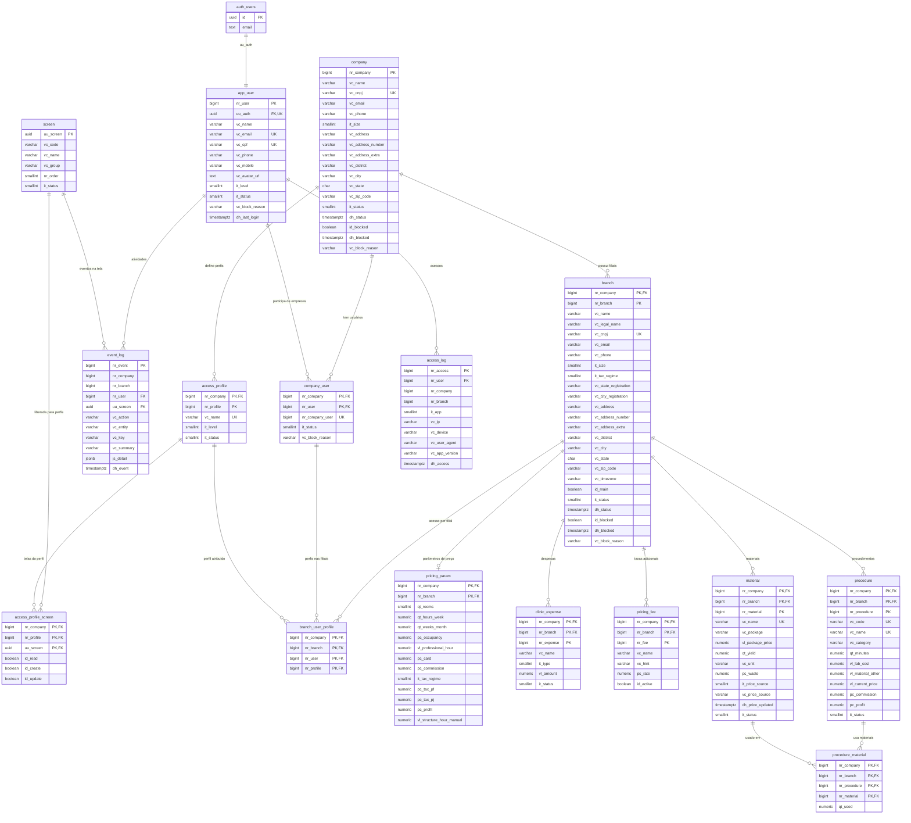

# Dicionário de dados — Supabase multi-company login

> Base multi-empresa / multi-filial do futuro sistema de odontologia. Schemas: **`ad`** (AD - Administrative (empresas, filiais, usuários, perfis, telas, logs)), **`od`** (OD - Odontologia (tabelas e helpers da precificação; RPCs expostas ficam em ad)), **`private`** (helpers de RLS, fora da API). Atualizado em 2026-10-14.
>
> **Gerado** por `node tools/gen-dictionary.mjs` a partir de [`docs/dictionary/schema.json`](dictionary/schema.json). Não edite este arquivo à mão.
> Viewer interativo: abra [`docs/dictionary/index.html`](dictionary/index.html) no navegador.
> O mesmo JSON vira `COMMENT ON` no banco (repeatable `R__zz_dictionary_comments.sql`): o dicionário aparece no Supabase Studio e em qualquer cliente SQL.

## Convenção de colunas

Formato `<prefixo>_<nome>` em inglês, sem o prefixo da tabela. Mesma coluna tem o mesmo nome em todas as tabelas (`nr_company` em company, branch, company_user...), o que permite `join ... using (nr_company)`.

| Prefixo | Significado |
|---|---|
| `nr_` | Numérico / identificador (bigint, smallint) |
| `vc_` | Texto (varchar, text) |
| `it_` | Indicador / tipo codificado (smallint com lista de valores) |
| `id_` | Booleano (true/false) |
| `dt_` | Data (date) |
| `dh_` | Data e hora com fuso (timestamptz) |
| `qt_` | Quantidade |
| `vl_` | Valor monetário (numeric) |
| `pc_` | Percentual |
| `uu_` | UUID |

Colunas de auditoria em **toda** tabela (preenchidas pelo trigger `ad.trg_audit`):

| Coluna | Tipo | Descrição |
|---|---|---|
| `nr_operator` | `bigint` | Usuário (ad.app_user.nr_user) da última alteração. Preenchido pelo trigger ad.trg_audit. |
| `dh_created` | `timestamptz` | Data/hora de inclusão do registro (trigger ad.trg_audit; nunca muda). |
| `dh_updated` | `timestamptz` | Data/hora da última atualização (trigger ad.trg_audit). |

## Visão geral das tabelas

| Tabela | Título | Descrição |
|---|---|---|
| [`ad.company`](#adcompany) | Empresa | Empresa (tenant principal). Toda informação de negócio pertence a uma empresa e, dentro dela, a uma filial. |
| [`ad.branch`](#adbranch) | Filial | Filial (unidade/clínica) da empresa. PK composta (nr_company, nr_branch) com numeração sequencial por empresa. Toda tabela de negócio futura referencia (nr_company, nr_branch). |
| [`ad.app_user`](#adappuser) | Usuário | Usuário do sistema. A autenticação (e-mail, senha, OTP, social, 2FA, tentativas) é do Supabase Auth (auth.users); aqui ficam o id numérico, nome e dados do app. Criado automaticamente pelo trigger ad.trg_auth_user_sync no signup. |
| [`ad.access_profile`](#adaccessprofile) | Perfil de acesso | Perfil de acesso da empresa (Administrador, Dentista, Recepção...). Numeração sequencial por empresa. company_create cria 1 = Administrador (nível 100) e 2 = Usuário (nível 0). A ligação perfil x telas ainda não existe neste projeto. |
| [`ad.company_user`](#adcompanyuser) | Empresa x Usuário | Vínculo do usuário com a empresa (multi-empresa: um usuário em N empresas). Situação do usuário DENTRO da empresa, independente da situação na plataforma. |
| [`ad.branch_user_profile`](#adbranchuserprofile) | Filial x Usuário x Perfil | Perfis do usuário em cada filial (multi-filial). É esta tabela que dá acesso: sem linha aqui numa filial ativa, o usuário não entra na empresa (SESSION_WITHOUT_PROFILE). ON DELETE CASCADE de branch e company_user. |
| [`ad.access_log`](#adaccesslog) | Log de acesso | Uma linha por session_context (login/restauração de sessão no app). IP e user-agent são lidos dos headers HTTP do request pelo PostgREST (request.headers). |
| [`ad.screen`](#adscreen) | Tela do app | Catálogo GLOBAL das telas do app (não depende de empresa). O uuid é a chave da permissão e é o mesmo em todos os ambientes (seed com uuids fixos); o código é usado pelo app para rotear e o nome é o que aparece para o usuário. DASHBOARD é implícita para todo usuário logado. |
| [`ad.access_profile_screen`](#adaccessprofilescreen) | Permissão do perfil por tela | Linha existe = o perfil pode LER a tela; id_create e id_update liberam criar e alterar. Perfil de nível 100 (administrador) ignora esta tabela: tem tudo. Substituída inteira por access_profile_save (screens). |
| [`ad.event_log`](#adeventlog) | Log de atividades | O que aconteceu no sistema: quem, quando, em qual tela, qual ação, qual registro, resumo legível e detalhe em JSON (nunca senhas). Gravado pelas RPCs via ad.fn_event_log; o app nunca escreve. Login/acesso fica em access_log. |
| [`od.pricing_param`](#odpricingparam) | Parâmetros de precificação | Parâmetros de precificação da filial: estrutura (salas, horas, ocupação), hora clínica do profissional, taxa de cartão, comissão padrão, regime do imposto de renda (PF/PJ) e lucro desejado. Uma linha por filial, criada no primeiro salvamento (pricing_param_save); antes disso pricing_param_get devolve os padrões sugeridos. Percentuais em pontos percentuais (4 = 4%). |
| [`od.clinic_expense`](#odclinicexpense) | Despesa da clínica | Despesas que formam o custo mensal da clínica (custo da estrutura): fixas mensais, variáveis mensais, eventuais anuais (divididas por 12) e publicidade mensal. Custo da estrutura por hora = custo mensal ÷ horas produtivas. A lista inteira é substituída a cada pricing_param_save. |
| [`od.pricing_fee`](#odpricingfee) | Taxa adicional de precificação | Taxas adicionais sobre o preço que a clínica liga ou desliga por filial (ISS, inadimplência, antecipação de recebíveis, garantia/retrabalho, margem de negociação, convênios...). Só as ativas entram no cálculo (somadas aos percentuais sobre o preço). pricing_param_get sugere uma lista inicial; a lista inteira é substituída a cada pricing_param_save. |
| [`od.material`](#odmaterial) | Material | Catálogo de materiais da filial. Custo por unidade de uso = preço da embalagem ÷ (rendimento × (1 − perda)). O preço pode ser digitado ou vir da pesquisa de mercado (Edge Function material-price-lookup), com a loja/URL de origem e a data da última atualização. |
| [`od.procedure`](#odprocedure) | Procedimento | Procedimento precificado: tempo de cadeira, laboratório/terceiros, outros materiais (valor informado), valor cobrado hoje (só comparação) e, opcionalmente, comissão e lucro próprios. O preço não é gravado: procedure_list calcula sempre com os parâmetros atuais (od.fn_pricing_calc). |
| [`od.procedure_material`](#odprocedurematerial) | Material do procedimento | Materiais usados em cada procedimento com a quantidade em unidades de uso. Custo da linha = quantidade × custo unitário do material. A lista é substituída a cada procedure_save com materials. |

## Diagrama (ERD)

## Tabelas

### ad.company

**Empresa**

Empresa (tenant principal). Toda informação de negócio pertence a uma empresa e, dentro dela, a uma filial.

**RLS:** SELECT: empresas em que o usuário tem pelo menos uma filial acessível (private.fn_my_companies). Escrita só via company_create / company_update.

| Coluna | Tipo | Chave | Nulo | Default | Descrição |
|---|---|---|---|---|---|
| `nr_company` | `bigint` | PK1 | NOT NULL | `identity` | Número da empresa. |
| `vc_name` | `varchar(60)` |  | NOT NULL |  | Nome da empresa. |
| `vc_cnpj` | `varchar(14)` | UK | NULL |  | CNPJ sem pontuação, 14 posições. Aceita o CNPJ alfanumérico (12 posições [A-Z0-9] + 2 dígitos). Único quando informado. |
| `vc_email` | `varchar(200)` |  | NULL |  | E-mail de contato da empresa (minúsculo). |
| `vc_phone` | `varchar(20)` |  | NULL |  | Telefone principal (DDD + número, livre). |
| `it_size` | `smallint` |  | NULL |  | Porte da empresa. Valores: 10 = MEI; 20 = Micro empresa (ME); 30 = Pequeno porte (EPP); 40 = Médio porte; 50 = Grande porte. |
| `vc_address` | `varchar(60)` |  | NULL |  | Logradouro. |
| `vc_address_number` | `varchar(10)` |  | NULL |  | Número do endereço. |
| `vc_address_extra` | `varchar(60)` |  | NULL |  | Complemento do endereço. |
| `vc_district` | `varchar(30)` |  | NULL |  | Bairro. |
| `vc_city` | `varchar(30)` |  | NULL |  | Cidade. |
| `vc_state` | `char(2)` |  | NULL |  | UF (2 letras maiúsculas). |
| `vc_zip_code` | `varchar(8)` |  | NULL |  | CEP, 8 dígitos sem pontuação. |
| `it_status` | `smallint` |  | NOT NULL | `1` | Situação da empresa. Valores: 1 = Ativa; 90 = Inativa. |
| `dh_status` | `timestamptz` |  | NOT NULL | `now()` | Data/hora da última mudança de situação. |
| `id_blocked` | `boolean` |  | NOT NULL | `false` | Empresa bloqueada pela plataforma (inadimplência, abuso). Bloqueada = ninguém entra; o motivo aparece em session_context.blocked. |
| `dh_blocked` | `timestamptz` |  | NULL |  | Data/hora do bloqueio. |
| `vc_block_reason` | `varchar(200)` |  | NULL |  | Motivo do bloqueio, exibido ao usuário. |
| `nr_operator` | `bigint` |  | NULL |  | Usuário (ad.app_user.nr_user) da última alteração. Preenchido pelo trigger ad.trg_audit. |
| `dh_created` | `timestamptz` |  | NOT NULL | `now()` | Data/hora de inclusão do registro (trigger ad.trg_audit; nunca muda). |
| `dh_updated` | `timestamptz` |  | NOT NULL | `now()` | Data/hora da última atualização (trigger ad.trg_audit). |

### ad.branch

**Filial**

Filial (unidade/clínica) da empresa. PK composta (nr_company, nr_branch) com numeração sequencial por empresa. Toda tabela de negócio futura referencia (nr_company, nr_branch).

**RLS:** SELECT: filiais acessíveis ao usuário (private.fn_my_branches). Escrita só via company_create (matriz), branch_create e branch_update.

| Coluna | Tipo | Chave | Nulo | Default | Descrição |
|---|---|---|---|---|---|
| `nr_company` | `bigint` | PK1, FK → `company.nr_company` | NOT NULL |  | Número da empresa. |
| `nr_branch` | `bigint` | PK2 | NOT NULL |  | Número da filial, sequencial dentro da empresa (1 = matriz criada com a empresa). |
| `vc_name` | `varchar(60)` |  | NOT NULL |  | Nome fantasia da filial. |
| `vc_legal_name` | `varchar(80)` |  | NULL |  | Razão social. |
| `vc_cnpj` | `varchar(14)` | UK | NULL |  | CNPJ da filial, sem pontuação (alfanumérico aceito). Único quando informado. |
| `vc_email` | `varchar(200)` |  | NULL |  | E-mail de contato da filial. |
| `vc_phone` | `varchar(20)` |  | NULL |  | Telefone principal. |
| `it_size` | `smallint` |  | NULL |  | Porte da filial. Valores: 10 = MEI; 20 = Micro empresa (ME); 30 = Pequeno porte (EPP); 40 = Médio porte; 50 = Grande porte. |
| `it_tax_regime` | `smallint` |  | NULL |  | Regime tributário. Valores: 10 = Simples Nacional MEI (SIMEI); 20 = Simples Nacional; 30 = Lucro Real; 40 = Lucro Presumido; 50 = Lucro Arbitrado. |
| `vc_state_registration` | `varchar(20)` |  | NULL |  | Inscrição estadual. |
| `vc_city_registration` | `varchar(20)` |  | NULL |  | Inscrição municipal. |
| `vc_address` | `varchar(60)` |  | NULL |  | Logradouro. |
| `vc_address_number` | `varchar(10)` |  | NULL |  | Número do endereço. |
| `vc_address_extra` | `varchar(60)` |  | NULL |  | Complemento do endereço. |
| `vc_district` | `varchar(30)` |  | NULL |  | Bairro. |
| `vc_city` | `varchar(30)` |  | NULL |  | Cidade. |
| `vc_state` | `char(2)` |  | NULL |  | UF. |
| `vc_zip_code` | `varchar(8)` |  | NULL |  | CEP, 8 dígitos. |
| `vc_timezone` | `varchar(60)` |  | NOT NULL | `'America/Sao_Paulo'` | Fuso horário IANA da filial (validado em pg_timezone_names). Base da agenda da clínica. |
| `id_main` | `boolean` |  | NOT NULL | `false` | Matriz. Única por empresa (índice branch_id_main_uk). |
| `it_status` | `smallint` |  | NOT NULL | `1` | Situação da filial. Valores: 1 = Ativa; 90 = Inativa. |
| `dh_status` | `timestamptz` |  | NOT NULL | `now()` | Data/hora da última mudança de situação. |
| `id_blocked` | `boolean` |  | NOT NULL | `false` | Filial bloqueada pela plataforma. |
| `dh_blocked` | `timestamptz` |  | NULL |  | Data/hora do bloqueio. |
| `vc_block_reason` | `varchar(200)` |  | NULL |  | Motivo do bloqueio. |
| `nr_operator` | `bigint` |  | NULL |  | Usuário (ad.app_user.nr_user) da última alteração. Preenchido pelo trigger ad.trg_audit. |
| `dh_created` | `timestamptz` |  | NOT NULL | `now()` | Data/hora de inclusão do registro (trigger ad.trg_audit; nunca muda). |
| `dh_updated` | `timestamptz` |  | NOT NULL | `now()` | Data/hora da última atualização (trigger ad.trg_audit). |

### ad.app_user

**Usuário**

Usuário do sistema. A autenticação (e-mail, senha, OTP, social, 2FA, tentativas) é do Supabase Auth (auth.users); aqui ficam o id numérico, nome e dados do app. Criado automaticamente pelo trigger ad.trg_auth_user_sync no signup.

**RLS:** SELECT: o próprio cadastro, ou cadastros de usuários vinculados a uma empresa que o usuário administra (private.fn_is_admin_of_user). Escrita só via user_update (próprio) e triggers.

| Coluna | Tipo | Chave | Nulo | Default | Descrição |
|---|---|---|---|---|---|
| `nr_user` | `bigint` | PK1 | NOT NULL | `identity` | Código do usuário. |
| `uu_auth` | `uuid` | UK, FK → `auth.users.id` | NOT NULL |  | Id do usuário no Supabase Auth (claim sub do JWT = auth.uid()). ON DELETE CASCADE. |
| `vc_name` | `varchar(60)` |  | NOT NULL |  | Nome do usuário (vem de raw_user_meta_data.name no signup). |
| `vc_email` | `varchar(200)` | UK | NULL |  | E-mail em minúsculo, espelho de auth.users.email (trigger). Nulo em login só por telefone. Usado por company_user_save para localizar quem vincular. |
| `vc_cpf` | `varchar(11)` | UK | NULL |  | CPF, 11 dígitos, validado (ad.fn_cpf_is_valid). Único quando informado. |
| `vc_phone` | `varchar(20)` |  | NULL |  | Telefone fixo. |
| `vc_mobile` | `varchar(20)` |  | NULL |  | Celular. |
| `vc_avatar_url` | `text` |  | NULL |  | URL da foto no Supabase Storage. |
| `it_level` | `smallint` |  | NOT NULL | `0` | Nível do usuário na plataforma. Alterável só por service_role. Valores: 0 = Normal; 100 = Administrador da plataforma (suporte). |
| `it_status` | `smallint` |  | NOT NULL | `1` | Situação do usuário na plataforma. Bloqueado/inativo não enxerga nada (private.fn_current_user_nr retorna NULL). Valores: 1 = Ativo; 80 = Bloqueado; 90 = Inativo. |
| `vc_block_reason` | `varchar(200)` |  | NULL |  | Motivo do bloqueio (devolvido em SESSION_USER_BLOCKED). |
| `dh_last_login` | `timestamptz` |  | NULL |  | Data/hora do último session_context (login no app). |
| `nr_operator` | `bigint` |  | NULL |  | Usuário (ad.app_user.nr_user) da última alteração. Preenchido pelo trigger ad.trg_audit. |
| `dh_created` | `timestamptz` |  | NOT NULL | `now()` | Data/hora de inclusão do registro (trigger ad.trg_audit; nunca muda). |
| `dh_updated` | `timestamptz` |  | NOT NULL | `now()` | Data/hora da última atualização (trigger ad.trg_audit). |

### ad.access_profile

**Perfil de acesso**

Perfil de acesso da empresa (Administrador, Dentista, Recepção...). Numeração sequencial por empresa. company_create cria 1 = Administrador (nível 100) e 2 = Usuário (nível 0). A ligação perfil x telas ainda não existe neste projeto.

**RLS:** SELECT: perfis das empresas acessíveis (private.fn_my_companies). Escrita só via access_profile_save.

| Coluna | Tipo | Chave | Nulo | Default | Descrição |
|---|---|---|---|---|---|
| `nr_company` | `bigint` | PK1, FK → `company.nr_company` | NOT NULL |  | Número da empresa. |
| `nr_profile` | `bigint` | PK2 | NOT NULL |  | Código do perfil, sequencial dentro da empresa. |
| `vc_name` | `varchar(30)` | UK | NOT NULL |  | Nome do perfil, único na empresa. |
| `it_level` | `smallint` |  | NOT NULL | `0` | Nível hierárquico 0..100. 100 = administrador da empresa (private.fn_is_company_admin). Valores: 0 = Usuário comum; 100 = Administrador da empresa. |
| `it_status` | `smallint` |  | NOT NULL | `1` | Situação do perfil. Inativo não concede acesso. Valores: 1 = Ativo; 90 = Inativo. |
| `nr_operator` | `bigint` |  | NULL |  | Usuário (ad.app_user.nr_user) da última alteração. Preenchido pelo trigger ad.trg_audit. |
| `dh_created` | `timestamptz` |  | NOT NULL | `now()` | Data/hora de inclusão do registro (trigger ad.trg_audit; nunca muda). |
| `dh_updated` | `timestamptz` |  | NOT NULL | `now()` | Data/hora da última atualização (trigger ad.trg_audit). |

### ad.company_user

**Empresa x Usuário**

Vínculo do usuário com a empresa (multi-empresa: um usuário em N empresas). Situação do usuário DENTRO da empresa, independente da situação na plataforma.

**RLS:** SELECT: os próprios vínculos, ou todos os vínculos das empresas que o usuário administra. Escrita só via company_create (criador) e company_user_save.

| Coluna | Tipo | Chave | Nulo | Default | Descrição |
|---|---|---|---|---|---|
| `nr_company` | `bigint` | PK1, FK → `company.nr_company` | NOT NULL |  | Número da empresa. |
| `nr_user` | `bigint` | PK2, FK → `app_user.nr_user` | NOT NULL |  | Código do usuário. |
| `nr_company_user` | `bigint` | UK | NOT NULL |  | Código do usuário dentro da empresa, sequencial (1 = criador). Útil como código curto de operador/profissional. |
| `it_status` | `smallint` |  | NOT NULL | `1` | Situação do usuário na empresa. Valores: 1 = Ativo; 80 = Bloqueado; 90 = Inativo. |
| `vc_block_reason` | `varchar(200)` |  | NULL |  | Motivo do bloqueio na empresa (devolvido em session_context.blocked). Limpo ao reativar. |
| `nr_operator` | `bigint` |  | NULL |  | Usuário (ad.app_user.nr_user) da última alteração. Preenchido pelo trigger ad.trg_audit. |
| `dh_created` | `timestamptz` |  | NOT NULL | `now()` | Data/hora de inclusão do registro (trigger ad.trg_audit; nunca muda). |
| `dh_updated` | `timestamptz` |  | NOT NULL | `now()` | Data/hora da última atualização (trigger ad.trg_audit). |

### ad.branch_user_profile

**Filial x Usuário x Perfil**

Perfis do usuário em cada filial (multi-filial). É esta tabela que dá acesso: sem linha aqui numa filial ativa, o usuário não entra na empresa (SESSION_WITHOUT_PROFILE). ON DELETE CASCADE de branch e company_user.

**RLS:** SELECT: os próprios vínculos, ou todos das empresas que o usuário administra. Escrita só via company_create, branch_create e company_user_save (ad.fn_set_user_branches).

| Coluna | Tipo | Chave | Nulo | Default | Descrição |
|---|---|---|---|---|---|
| `nr_company` | `bigint` | PK1, FK → `branch.nr_company` | NOT NULL |  | Número da empresa. |
| `nr_branch` | `bigint` | PK2, FK → `branch.nr_branch` | NOT NULL |  | Número da filial. |
| `nr_user` | `bigint` | PK3, FK → `company_user.nr_user` | NOT NULL |  | Código do usuário (precisa estar vinculado à empresa em company_user). |
| `nr_profile` | `bigint` | PK4, FK → `access_profile.nr_profile` | NOT NULL |  | Perfil do usuário nesta filial. |
| `nr_operator` | `bigint` |  | NULL |  | Usuário (ad.app_user.nr_user) da última alteração. Preenchido pelo trigger ad.trg_audit. |
| `dh_created` | `timestamptz` |  | NOT NULL | `now()` | Data/hora de inclusão do registro (trigger ad.trg_audit; nunca muda). |
| `dh_updated` | `timestamptz` |  | NOT NULL | `now()` | Data/hora da última atualização (trigger ad.trg_audit). |

### ad.access_log

**Log de acesso**

Uma linha por session_context (login/restauração de sessão no app). IP e user-agent são lidos dos headers HTTP do request pelo PostgREST (request.headers).

**RLS:** SELECT: os próprios acessos. Escrita só via session_context.

| Coluna | Tipo | Chave | Nulo | Default | Descrição |
|---|---|---|---|---|---|
| `nr_access` | `bigint` | PK1 | NOT NULL | `identity` | Número do acesso. |
| `nr_user` | `bigint` | FK → `app_user.nr_user` | NOT NULL |  | Usuário que acessou. |
| `nr_company` | `bigint` |  | NULL |  | Empresa que o app abriu (quando informada). |
| `nr_branch` | `bigint` |  | NULL |  | Filial que o app abriu (quando informada). |
| `it_app` | `smallint` |  | NULL |  | Tipo de aplicativo. Valores: 1 = Web; 2 = Android; 3 = iOS; 9 = Outro. |
| `vc_ip` | `varchar(60)` |  | NULL |  | IP de origem (header x-forwarded-for, primeiro valor). |
| `vc_device` | `varchar(200)` |  | NULL |  | Dispositivo/modelo informado pelo app. |
| `vc_user_agent` | `varchar(800)` |  | NULL |  | Header user-agent do request. |
| `vc_app_version` | `varchar(30)` |  | NULL |  | Versão do app informada em session_context. |
| `dh_access` | `timestamptz` |  | NOT NULL | `now()` | Data/hora do acesso. |
| `nr_operator` | `bigint` |  | NULL |  | Usuário (ad.app_user.nr_user) da última alteração. Preenchido pelo trigger ad.trg_audit. |
| `dh_created` | `timestamptz` |  | NOT NULL | `now()` | Data/hora de inclusão do registro (trigger ad.trg_audit; nunca muda). |
| `dh_updated` | `timestamptz` |  | NOT NULL | `now()` | Data/hora da última atualização (trigger ad.trg_audit). |

### ad.screen

**Tela do app**

Catálogo GLOBAL das telas do app (não depende de empresa). O uuid é a chave da permissão e é o mesmo em todos os ambientes (seed com uuids fixos); o código é usado pelo app para rotear e o nome é o que aparece para o usuário. DASHBOARD é implícita para todo usuário logado.

**RLS:** SELECT: qualquer usuário logado (telas ativas). Escrita só por migration/seed.

| Coluna | Tipo | Chave | Nulo | Default | Descrição |
|---|---|---|---|---|---|
| `uu_screen` | `uuid` | PK1 | NOT NULL | `gen_random_uuid()` | Id da tela. É a chave usada em access_profile_screen e event_log. |
| `vc_code` | `varchar(30)` |  | NOT NULL |  | Código estável da tela (DASHBOARD, USERS, PROFILES, LOGS). Único; usado pelo app para rotear. |
| `vc_name` | `varchar(60)` |  | NOT NULL |  | Nome bonito da tela, mostrado ao usuário. |
| `vc_group` | `varchar(30)` |  | NULL |  | Agrupamento no menu (ex.: Administração). |
| `nr_order` | `smallint` |  | NOT NULL | `0` | Ordem no menu. |
| `it_status` | `smallint` |  | NOT NULL | `1` | Situação da tela. Valores: 1 = Ativa; 90 = Inativa. |
| `nr_operator` | `bigint` |  | NULL |  | Usuário (ad.app_user.nr_user) da última alteração. Preenchido pelo trigger ad.trg_audit. |
| `dh_created` | `timestamptz` |  | NOT NULL | `now()` | Data/hora de inclusão do registro (trigger ad.trg_audit; nunca muda). |
| `dh_updated` | `timestamptz` |  | NOT NULL | `now()` | Data/hora da última atualização (trigger ad.trg_audit). |

### ad.access_profile_screen

**Permissão do perfil por tela**

Linha existe = o perfil pode LER a tela; id_create e id_update liberam criar e alterar. Perfil de nível 100 (administrador) ignora esta tabela: tem tudo. Substituída inteira por access_profile_save (screens).

**RLS:** SELECT: usuários da empresa. Escrita só via access_profile_save.

| Coluna | Tipo | Chave | Nulo | Default | Descrição |
|---|---|---|---|---|---|
| `nr_company` | `bigint` | PK1, FK → `access_profile.nr_company` | NOT NULL |  | Número da empresa. |
| `nr_profile` | `bigint` | PK2, FK → `access_profile.nr_profile` | NOT NULL |  | Perfil de acesso. |
| `uu_screen` | `uuid` | PK3, FK → `screen.uu_screen` | NOT NULL |  | Tela liberada. |
| `id_read` | `boolean` |  | NOT NULL | `true` | Pode ler (sempre verdadeiro quando a linha existe; check impede criar/alterar sem ler). |
| `id_create` | `boolean` |  | NOT NULL | `false` | Pode criar registros na tela. |
| `id_update` | `boolean` |  | NOT NULL | `false` | Pode alterar registros na tela. |
| `nr_operator` | `bigint` |  | NULL |  | Usuário (ad.app_user.nr_user) da última alteração. Preenchido pelo trigger ad.trg_audit. |
| `dh_created` | `timestamptz` |  | NOT NULL | `now()` | Data/hora de inclusão do registro (trigger ad.trg_audit; nunca muda). |
| `dh_updated` | `timestamptz` |  | NOT NULL | `now()` | Data/hora da última atualização (trigger ad.trg_audit). |

### ad.event_log

**Log de atividades**

O que aconteceu no sistema: quem, quando, em qual tela, qual ação, qual registro, resumo legível e detalhe em JSON (nunca senhas). Gravado pelas RPCs via ad.fn_event_log; o app nunca escreve. Login/acesso fica em access_log.

**RLS:** SELECT: os próprios eventos. A tela de logs usa event_log_list (admin vê a empresa).

| Coluna | Tipo | Chave | Nulo | Default | Descrição |
|---|---|---|---|---|---|
| `nr_event` | `bigint` | PK1 | NOT NULL | `identity` | Número do evento. |
| `nr_company` | `bigint` |  | NULL |  | Empresa do contexto. |
| `nr_branch` | `bigint` |  | NULL |  | Filial aberta no app quando a ação foi feita (p_json.nr_branch). |
| `nr_user` | `bigint` | FK → `app_user.nr_user` | NOT NULL |  | Quem fez. |
| `uu_screen` | `uuid` | FK → `screen.uu_screen` | NULL |  | Tela em que a ação aconteceu (nula para ações sem tela, ex.: empresa/filial). |
| `vc_action` | `varchar(20)` |  | NOT NULL |  | Tipo da ação. Valores: CREATE = Criação; UPDATE = Alteração; DELETE = Exclusão; OTHER = Outra. |
| `vc_entity` | `varchar(40)` |  | NOT NULL |  | Entidade afetada (access_profile, company_user, branch, company, app_user). |
| `vc_key` | `varchar(60)` |  | NULL |  | Chave do registro em texto (ex.: 1/3). |
| `vc_summary` | `varchar(200)` |  | NOT NULL |  | Resumo legível (ex.: Perfil Recepção criado). |
| `js_detail` | `jsonb` |  | NULL |  | Detalhe da ação (campos enviados), sem dados sensíveis. |
| `dh_event` | `timestamptz` |  | NOT NULL | `now()` | Data/hora do evento. |
| `nr_operator` | `bigint` |  | NULL |  | Usuário (ad.app_user.nr_user) da última alteração. Preenchido pelo trigger ad.trg_audit. |
| `dh_created` | `timestamptz` |  | NOT NULL | `now()` | Data/hora de inclusão do registro (trigger ad.trg_audit; nunca muda). |
| `dh_updated` | `timestamptz` |  | NOT NULL | `now()` | Data/hora da última atualização (trigger ad.trg_audit). |

### od.pricing_param

**Parâmetros de precificação**

Parâmetros de precificação da filial: estrutura (salas, horas, ocupação), hora clínica do profissional, taxa de cartão, comissão padrão, regime do imposto de renda (PF/PJ) e lucro desejado. Uma linha por filial, criada no primeiro salvamento (pricing_param_save); antes disso pricing_param_get devolve os padrões sugeridos. Percentuais em pontos percentuais (4 = 4%).

**RLS:** SELECT: filiais acessíveis (private.fn_my_branches). Escrita só via pricing_param_save (permissão na tela PRICING).

| Coluna | Tipo | Chave | Nulo | Default | Descrição |
|---|---|---|---|---|---|
| `nr_company` | `bigint` | PK1, FK → `branch.nr_company` | NOT NULL |  | Número da empresa. |
| `nr_branch` | `bigint` | PK2, FK → `branch.nr_branch` | NOT NULL |  | Número da filial. |
| `qt_rooms` | `smallint` |  | NOT NULL | `1` | Salas (cadeiras) em uso na filial. |
| `qt_hours_week` | `numeric(6,2)` |  | NOT NULL | `40` | Horas de atendimento por semana, por sala. |
| `qt_weeks_month` | `numeric(4,2)` |  | NOT NULL | `4.33` | Semanas por mês (4,33 = 52 ÷ 12). |
| `pc_occupancy` | `numeric(5,2)` |  | NOT NULL | `70` | Taxa de ocupação da agenda (%): parte das horas abertas que realmente vira atendimento. Horas produtivas = horas abertas × ocupação. |
| `vl_professional_hour` | `numeric(12,2)` |  | NOT NULL | `0` | Hora clínica do profissional (R$/h): remuneração do dentista por hora de cadeira, entra no custo direto. |
| `pc_card` | `numeric(5,2)` |  | NOT NULL | `4` | Taxa média da máquina de cartão (% sobre o preço; média de débito/crédito/parcelado). |
| `pc_commission` | `numeric(5,2)` |  | NOT NULL | `0` | Comissão padrão (% sobre o preço), ex.: recepção/captação. Cada procedimento pode ter a sua própria (procedure.pc_commission). |
| `it_tax_regime` | `smallint` |  | NOT NULL | `1` | Regime do imposto de renda usado no preço. Valores: 1 = Pessoa física (IR sobre o lucro, carnê-leão); 2 = Pessoa jurídica (tributos sobre o faturamento). |
| `pc_tax_pf` | `numeric(5,2)` |  | NOT NULL | `27.5` | Imposto de renda pessoa física (%): incide sobre o lucro do procedimento (receita − custos − taxas). Padrão 27,5% = faixa máxima do carnê-leão; use a alíquota efetiva. |
| `pc_tax_pj` | `numeric(5,2)` |  | NOT NULL | `11.33` | Tributos pessoa jurídica (%): alíquota efetiva do regime sobre o faturamento (Simples Nacional: 6% a 15,5%; Lucro Presumido: 11,33% + ISS). Padrão 11,33%. |
| `pc_profit` | `numeric(5,2)` |  | NOT NULL | `30` | Lucro desejado padrão (% sobre o preço). Cada procedimento pode ter o seu próprio (procedure.pc_profit). |
| `vl_structure_hour_manual` | `numeric(12,2)` |  | NULL |  | Custo da estrutura por hora informado manualmente (R$/h). Quando preenchido substitui o cálculo (custo mensal ÷ horas produtivas), como a planilha original que digitava R$ 30 sobre os R$ 30,36 calculados. Nulo = usa o cálculo. |
| `nr_operator` | `bigint` |  | NULL |  | Usuário (ad.app_user.nr_user) da última alteração. Preenchido pelo trigger ad.trg_audit. |
| `dh_created` | `timestamptz` |  | NOT NULL | `now()` | Data/hora de inclusão do registro (trigger ad.trg_audit; nunca muda). |
| `dh_updated` | `timestamptz` |  | NOT NULL | `now()` | Data/hora da última atualização (trigger ad.trg_audit). |

### od.clinic_expense

**Despesa da clínica**

Despesas que formam o custo mensal da clínica (custo da estrutura): fixas mensais, variáveis mensais, eventuais anuais (divididas por 12) e publicidade mensal. Custo da estrutura por hora = custo mensal ÷ horas produtivas. A lista inteira é substituída a cada pricing_param_save.

**RLS:** SELECT: filiais acessíveis (private.fn_my_branches). Escrita só via pricing_param_save.

| Coluna | Tipo | Chave | Nulo | Default | Descrição |
|---|---|---|---|---|---|
| `nr_company` | `bigint` | PK1, FK → `branch.nr_company` | NOT NULL |  | Número da empresa. |
| `nr_branch` | `bigint` | PK2, FK → `branch.nr_branch` | NOT NULL |  | Número da filial. |
| `nr_expense` | `bigint` | PK3 | NOT NULL |  | Número sequencial da despesa na filial. |
| `vc_name` | `varchar(60)` |  | NOT NULL |  | Nome da despesa (Aluguel, Energia, Salários...). |
| `it_type` | `smallint` |  | NOT NULL | `1` | Tipo da despesa. Valores: 1 = Fixa mensal; 2 = Variável mensal; 3 = Eventual anual (÷ 12 no custo mensal); 4 = Publicidade mensal. |
| `vl_amount` | `numeric(12,2)` |  | NOT NULL | `0` | Valor (mensal, ou anual quando it_type = 3). |
| `it_status` | `smallint` |  | NOT NULL | `1` | Situação da despesa. Valores: 1 = Ativa; 90 = Inativa. |
| `nr_operator` | `bigint` |  | NULL |  | Usuário (ad.app_user.nr_user) da última alteração. Preenchido pelo trigger ad.trg_audit. |
| `dh_created` | `timestamptz` |  | NOT NULL | `now()` | Data/hora de inclusão do registro (trigger ad.trg_audit; nunca muda). |
| `dh_updated` | `timestamptz` |  | NOT NULL | `now()` | Data/hora da última atualização (trigger ad.trg_audit). |

### od.pricing_fee

**Taxa adicional de precificação**

Taxas adicionais sobre o preço que a clínica liga ou desliga por filial (ISS, inadimplência, antecipação de recebíveis, garantia/retrabalho, margem de negociação, convênios...). Só as ativas entram no cálculo (somadas aos percentuais sobre o preço). pricing_param_get sugere uma lista inicial; a lista inteira é substituída a cada pricing_param_save.

**RLS:** SELECT: filiais acessíveis (private.fn_my_branches). Escrita só via pricing_param_save.

| Coluna | Tipo | Chave | Nulo | Default | Descrição |
|---|---|---|---|---|---|
| `nr_company` | `bigint` | PK1, FK → `branch.nr_company` | NOT NULL |  | Número da empresa. |
| `nr_branch` | `bigint` | PK2, FK → `branch.nr_branch` | NOT NULL |  | Número da filial. |
| `nr_fee` | `bigint` | PK3 | NOT NULL |  | Número sequencial da taxa na filial. |
| `vc_name` | `varchar(60)` |  | NOT NULL |  | Nome da taxa (ISS, Inadimplência...). |
| `vc_hint` | `varchar(200)` |  | NULL |  | Explicação curta mostrada na tela (quando usar, faixa típica). |
| `pc_rate` | `numeric(5,2)` |  | NOT NULL | `0` | Percentual sobre o preço (pontos percentuais). |
| `id_active` | `boolean` |  | NOT NULL | `false` | Entra no cálculo do preço? |
| `nr_operator` | `bigint` |  | NULL |  | Usuário (ad.app_user.nr_user) da última alteração. Preenchido pelo trigger ad.trg_audit. |
| `dh_created` | `timestamptz` |  | NOT NULL | `now()` | Data/hora de inclusão do registro (trigger ad.trg_audit; nunca muda). |
| `dh_updated` | `timestamptz` |  | NOT NULL | `now()` | Data/hora da última atualização (trigger ad.trg_audit). |

### od.material

**Material**

Catálogo de materiais da filial. Custo por unidade de uso = preço da embalagem ÷ (rendimento × (1 − perda)). O preço pode ser digitado ou vir da pesquisa de mercado (Edge Function material-price-lookup), com a loja/URL de origem e a data da última atualização.

**RLS:** SELECT: filiais acessíveis (private.fn_my_branches). Escrita só via material_save (permissão na tela PRICING).

| Coluna | Tipo | Chave | Nulo | Default | Descrição |
|---|---|---|---|---|---|
| `nr_company` | `bigint` | PK1, FK → `branch.nr_company` | NOT NULL |  | Número da empresa. |
| `nr_branch` | `bigint` | PK2, FK → `branch.nr_branch` | NOT NULL |  | Número da filial. |
| `nr_material` | `bigint` | PK3 | NOT NULL |  | Número sequencial do material na filial. |
| `vc_name` | `varchar(80)` | UK | NOT NULL |  | Nome do material (único na filial, sem diferenciar maiúsculas). |
| `vc_package` | `varchar(40)` |  | NULL |  | Embalagem comprada (ex.: Caixa 100, Seringa 4 g). |
| `vl_package_price` | `numeric(12,2)` |  | NOT NULL | `0` | Preço da embalagem (R$). |
| `qt_yield` | `numeric(10,3)` |  | NOT NULL | `1` | Rendimento: quantas unidades de uso a embalagem rende (ex.: caixa com 100 luvas = 100; seringa de 4 g usada 0,1 g por vez = 40). |
| `vc_unit` | `varchar(20)` |  | NULL |  | Unidade de uso (unidade, par, g, ml, aplicação...). |
| `pc_waste` | `numeric(5,2)` |  | NOT NULL | `0` | Perda / desperdício (%), reduz o rendimento efetivo. |
| `it_price_source` | `smallint` |  | NOT NULL | `1` | Origem do preço. Valores: 1 = Manual (digitado); 2 = Pesquisa de mercado (Edge Function material-price-lookup). |
| `vc_price_source` | `varchar(200)` |  | NULL |  | Loja / URL de onde o preço veio. |
| `dh_price_updated` | `timestamptz` |  | NULL |  | Data/hora da última atualização de preço, rendimento ou perda. |
| `it_status` | `smallint` |  | NOT NULL | `1` | Situação do material. Valores: 1 = Ativo; 90 = Inativo. |
| `nr_operator` | `bigint` |  | NULL |  | Usuário (ad.app_user.nr_user) da última alteração. Preenchido pelo trigger ad.trg_audit. |
| `dh_created` | `timestamptz` |  | NOT NULL | `now()` | Data/hora de inclusão do registro (trigger ad.trg_audit; nunca muda). |
| `dh_updated` | `timestamptz` |  | NOT NULL | `now()` | Data/hora da última atualização (trigger ad.trg_audit). |

### od.procedure

**Procedimento**

Procedimento precificado: tempo de cadeira, laboratório/terceiros, outros materiais (valor informado), valor cobrado hoje (só comparação) e, opcionalmente, comissão e lucro próprios. O preço não é gravado: procedure_list calcula sempre com os parâmetros atuais (od.fn_pricing_calc).

**RLS:** SELECT: filiais acessíveis (private.fn_my_branches). Escrita só via procedure_save (permissão na tela PRICING).

| Coluna | Tipo | Chave | Nulo | Default | Descrição |
|---|---|---|---|---|---|
| `nr_company` | `bigint` | PK1, FK → `branch.nr_company` | NOT NULL |  | Número da empresa. |
| `nr_branch` | `bigint` | PK2, FK → `branch.nr_branch` | NOT NULL |  | Número da filial. |
| `nr_procedure` | `bigint` | PK3 | NOT NULL |  | Número sequencial do procedimento na filial. |
| `vc_code` | `varchar(10)` | UK | NULL |  | Código da tabela da clínica (ex.: 3.1). Único na filial quando informado. |
| `vc_name` | `varchar(80)` | UK | NOT NULL |  | Nome do procedimento (único na filial). |
| `vc_category` | `varchar(40)` |  | NULL |  | Categoria / especialidade (Clínica Geral, Ortodontia, Implante, HOF...). |
| `qt_minutes` | `numeric(7,2)` |  | NOT NULL | `0` | Tempo de cadeira em minutos: define o custo da estrutura e a hora clínica do profissional. |
| `vl_lab_cost` | `numeric(12,2)` |  | NOT NULL | `0` | Laboratório / terceiros (R$), entra no custo direto. |
| `vl_material_other` | `numeric(12,2)` |  | NOT NULL | `0` | Outros materiais (R$ informado), somado aos materiais cadastrados. |
| `vl_current_price` | `numeric(12,2)` |  | NULL |  | Valor cobrado hoje (R$), só para comparar com o preço sugerido. |
| `pc_commission` | `numeric(5,2)` |  | NULL |  | Comissão própria (% sobre o preço). Nula = usa pricing_param.pc_commission. |
| `pc_profit` | `numeric(5,2)` |  | NULL |  | Lucro desejado próprio (% sobre o preço). Nulo = usa pricing_param.pc_profit. |
| `it_status` | `smallint` |  | NOT NULL | `1` | Situação do procedimento. Valores: 1 = Ativo; 90 = Inativo. |
| `nr_operator` | `bigint` |  | NULL |  | Usuário (ad.app_user.nr_user) da última alteração. Preenchido pelo trigger ad.trg_audit. |
| `dh_created` | `timestamptz` |  | NOT NULL | `now()` | Data/hora de inclusão do registro (trigger ad.trg_audit; nunca muda). |
| `dh_updated` | `timestamptz` |  | NOT NULL | `now()` | Data/hora da última atualização (trigger ad.trg_audit). |

### od.procedure_material

**Material do procedimento**

Materiais usados em cada procedimento com a quantidade em unidades de uso. Custo da linha = quantidade × custo unitário do material. A lista é substituída a cada procedure_save com materials.

**RLS:** SELECT: filiais acessíveis (private.fn_my_branches). Escrita só via procedure_save.

| Coluna | Tipo | Chave | Nulo | Default | Descrição |
|---|---|---|---|---|---|
| `nr_company` | `bigint` | PK1, FK → `procedure.nr_company` | NOT NULL |  | Número da empresa. |
| `nr_branch` | `bigint` | PK2, FK → `procedure.nr_branch` | NOT NULL |  | Número da filial. |
| `nr_procedure` | `bigint` | PK3, FK → `procedure.nr_procedure` | NOT NULL |  | Procedimento. |
| `nr_material` | `bigint` | PK4, FK → `material.nr_material` | NOT NULL |  | Material usado. |
| `qt_used` | `numeric(10,3)` |  | NOT NULL | `1` | Quantidade usada, em unidades de uso do material (> 0). |
| `nr_operator` | `bigint` |  | NULL |  | Usuário (ad.app_user.nr_user) da última alteração. Preenchido pelo trigger ad.trg_audit. |
| `dh_created` | `timestamptz` |  | NOT NULL | `now()` | Data/hora de inclusão do registro (trigger ad.trg_audit; nunca muda). |
| `dh_updated` | `timestamptz` |  | NOT NULL | `now()` | Data/hora da última atualização (trigger ad.trg_audit). |

## Functions

Contrato das RPC: `p_json jsonb` de entrada (sempre com `nr_version`), `jsonb` de saída, erros via `RAISE EXCEPTION` com `ad.fn_message` (`{"Message": "CHAVE", "Parameters": {...}}`). Chamada no Flutter: `supabase.schema('<schema>').rpc('<nome>', params: {'p_json': {...}})` (`ad` ou `od`, conforme a assinatura).

### RPC (expostas ao app)

| Function | Grant | Descrição |
|---|---|---|
| `ad.session_context(p_json jsonb)` | authenticated | Login do app após o Supabase Auth: devolve usuário, empresas → filiais → perfis acessíveis (com it_level e id_admin) e vínculos bloqueados com motivo; grava access_log e dh_last_login. Cada filial traz permissions: telas que o usuário pode ler/criar/alterar (nível 100 tem todas; DASHBOARD sempre). |
| `ad.company_create(p_json jsonb)` | authenticated | Onboarding: cria empresa, matriz (filial 1), perfis Administrador/Usuário e vincula o criador como administrador. Qualquer usuário ativo pode criar. |
| `ad.company_update(p_json jsonb)` | authenticated | Atualização parcial dos dados cadastrais da empresa. Somente administrador. Situação/bloqueio só por service_role. |
| `ad.branch_create(p_json jsonb)` | authenticated | Cria filial (numeração sequencial por empresa, serializada com FOR UPDATE na empresa) e vincula o criador com o seu perfil de maior nível. Somente administrador. |
| `ad.branch_update(p_json jsonb)` | authenticated | Atualização parcial da filial, inclusive transferência de matriz (id_main). Somente administrador. |
| `ad.access_profile_save(p_json jsonb)` | authenticated | Cria (I) ou atualiza (U) perfis de acesso da empresa; screens (opcional) substitui as permissões por tela (ler/criar/alterar). Guarda contra deixar a empresa sem administrador ativo. Grava event_log. Somente administrador. |
| `ad.company_user_save(p_json jsonb)` | authenticated | Vincula (I, por e-mail de usuário já cadastrado no Auth), altera (U: situação, motivo, filiais/perfis) ou remove (D) um usuário da empresa. Guarda do último administrador. Somente administrador. Grava event_log. |
| `ad.user_update(p_json jsonb)` | authenticated | Autoatendimento: nome, CPF (validado), telefones e avatar do próprio usuário. E-mail/senha mudam pelo Supabase Auth. |
| `ad.branch_list(p_json jsonb)` | authenticated | Lista as filiais da empresa: administrador vê todas, usuário comum só as filiais em que tem perfil ativo. Opção id_include_inactive. O app nunca lê ad.branch direto. |
| `ad.access_profile_list(p_json jsonb)` | authenticated | Lista os perfis de acesso da empresa com a quantidade de usuários e as telas liberadas (ler/criar/alterar) de cada um. Qualquer usuário ativo da empresa. Opção id_include_inactive. |
| `ad.company_user_list(p_json jsonb)` | authenticated | Lista paginada dos usuários da empresa com cadastro, situação e filiais × perfis; filtros por nome/e-mail, situação e filial. Somente administrador. |
| `ad.access_log_list(p_json jsonb)` | authenticated | Log de acesso paginado no contexto da empresa (padrão: últimos 30 dias). Administrador vê os acessos à empresa e os sem empresa escolhida dos seus usuários; usuário comum só os próprios. Filtros por usuário, app e período. |
| `ad.screen_list(p_json jsonb)` | authenticated | Catálogo de telas ativas do app na ordem do menu (uuid, código, nome, grupo). Qualquer usuário logado. |
| `ad.event_log_list(p_json jsonb)` | authenticated | Log de atividades paginado no contexto da empresa (padrão: últimos 30 dias), pesquisável por tela, ação, usuário, texto e período. Administrador vê a empresa; usuário comum só os próprios eventos. |
| `ad.user_create_check(p_json jsonb)` | authenticated | Pré-checagem do cadastro de usuário pela empresa, usada pela Edge Function user-create antes de criar a conta no Auth: administrador?, e-mail válido?, já vinculado?, conta já existe? |
| `ad.pricing_param_get(p_json jsonb)` | authenticated | Aba Parâmetros da precificação: parâmetros da filial (ou padrões sugeridos quando ainda não salvos), resumo calculado (custo mensal, horas produtivas, custo da estrutura por hora, soma das taxas ativas, IR do regime), despesas, taxas adicionais e a permissão do usuário na tela PRICING. Exige leitura na tela PRICING. |
| `ad.pricing_param_save(p_json jsonb)` | authenticated | Salva parâmetros (parcial; vl_structure_hour_manual null volta ao cálculo), despesas e taxas adicionais (listas substituídas) da filial; valida que os percentuais do regime deixam divisor positivo. Permissão criar (1ª vez) / alterar na tela PRICING. Grava event_log. |
| `ad.material_list(p_json jsonb)` | authenticated | Catálogo de materiais da filial com o custo por unidade de uso e em quantos procedimentos cada um é usado. Filtros: id_include_inactive, vc_search. Exige leitura na tela PRICING. |
| `ad.material_save(p_json jsonb)` | authenticated | Cria (I, permissão criar) ou atualiza parcialmente (U, permissão alterar) um material: embalagem, preço, rendimento, unidade, perda, origem do preço (manual / pesquisa de mercado), situação. Grava event_log. |
| `ad.procedure_list(p_json jsonb)` | authenticated | Procedimentos da filial com materiais, preço calculado (fn_pricing_calc), preço mínimo, decomposição (cartão, comissão, taxas, IR, lucro) e alertas (NO_TIME, NO_MATERIAL, MATERIAL_NO_PRICE, PERCENT_TOO_HIGH). it_tax_regime simula PF x PJ. Devolve também parâmetros, resumo e categorias. Exige leitura na tela PRICING. |
| `ad.procedure_save(p_json jsonb)` | authenticated | Cria (I, permissão criar) ou atualiza parcialmente (U, permissão alterar) um procedimento e, quando materials está presente, substitui seus materiais x quantidades. Grava event_log. |

### Helpers (regras compartilhadas / RLS)

| Function | Grant | Descrição |
|---|---|---|
| `ad.fn_event_log(p_nr_user bigint, p_nr_company bigint, p_nr_branch bigint, p_vc_screen text, p_vc_action text, p_vc_entity text, p_vc_key text, p_vc_summary text, p_js_detail jsonb)` | interna | Grava uma linha em event_log (quem, empresa, filial, tela por código, ação, entidade, chave, resumo, detalhe). Chamada pelas RPCs que alteram dados. |
| `private.fn_current_user_nr()` | authenticated (usada nas policies; schema private, fora da API) | auth.uid() → ad.app_user.nr_user do usuário logado e ativo; NULL sem sessão ou bloqueado. STABLE, SECURITY DEFINER. |
| `private.fn_my_branches()` | authenticated (usada nas policies; schema private, fora da API) | Pares (nr_company, nr_branch) acessíveis agora: vínculo com perfil ativo, usuário ativo na empresa, empresa e filial ativas e não bloqueadas. |
| `private.fn_my_companies()` | authenticated (usada nas policies; schema private, fora da API) | Empresas com pelo menos uma filial acessível (derivada de fn_my_branches). |
| `private.fn_is_company_admin(p_nr_company bigint)` | authenticated (usada nas policies; schema private, fora da API) | TRUE se o usuário logado tem perfil ativo de nível ≥ 100 em alguma filial acessível da empresa. |
| `private.fn_is_admin_of_user(p_nr_user bigint)` | authenticated (usada nas policies; schema private, fora da API) | TRUE se o usuário logado administra alguma empresa em que p_nr_user está vinculado (policy de app_user). |
| `ad.fn_company_has_admin(p_nr_company bigint)` | interna | TRUE se a empresa ainda tem um administrador ativo em filial ativa. Guarda anti-lockout de access_profile_save e company_user_save. |
| `ad.fn_set_user_branches(p_nr_company bigint, p_nr_user bigint, p_branches jsonb, p_nr_operator bigint)` | interna | Substitui os vínculos filial x perfil de um usuário na empresa, validando filial e perfil. |
| `ad.fn_check_version(p_nr_version integer, p_nr_expected integer, p_vc_function text)` | interna | Compara nr_version do app com a versão do contrato da function; RAISE VERSION_MISMATCH se diferente. |
| `ad.fn_message(p_vc_key text, p_jb_params jsonb)` | interna | Monta a mensagem de erro padrão {"Message": chave, "Parameters": {...}} para o app traduzir. |
| `ad.fn_cnpj_is_valid(p_vc_cnpj text)` | interna | Dígitos verificadores do CNPJ, inclusive alfanumérico (07/2026). |
| `ad.fn_cnpj_normalize(p_vc_cnpj text)` | interna | Remove pontuação, maiúsculas, NULL para vazio. |
| `ad.fn_cpf_is_valid(p_vc_cpf text)` | interna | Dígitos verificadores do CPF. |
| `ad.fn_email_is_valid(p_vc_email text)` | interna | Validação sintática mínima de e-mail de contato. |
| `od.fn_pricing_calc(p_json jsonb)` | interna | Fórmula do preço: custo direto = materiais + laboratório + tempo × estrutura/h + tempo × hora clínica; preço = custo ÷ (1 − cartão − comissão − taxas − IR − lucro) no regime PJ (IR sobre o faturamento) ou (1 − IR) × custo ÷ ((1 − IR)(1 − cartão − comissão − taxas) − lucro) no regime PF (IR sobre o lucro); preço mínimo com lucro zero. Devolve a decomposição e id_valid. |
| `od.fn_pricing_context(p_nr_company bigint, p_nr_branch bigint)` | interna | Parâmetros da filial (ou padrões) e resumo: custo mensal das despesas (eventuais ÷ 12), horas por mês, horas produtivas, custo da estrutura por hora (calculado e o efetivo, que pode ser o valor manual), soma das taxas ativas e IR do regime. |
| `ad.fn_screen_permission(p_nr_company bigint, p_nr_branch bigint, p_vc_screen text)` | interna | Permissão efetiva do usuário logado numa tela e filial ({id_read, id_create, id_update}): filial acessível + nível 100 ou união das linhas de access_profile_screen dos perfis do usuário. Usada pelas RPCs de negócio (schema od). |

### Triggers

| Function | Grant | Descrição |
|---|---|---|
| `ad.trg_audit()` | interna | BEFORE INSERT OR UPDATE em todas as tabelas: preenche nr_operator, dh_created, dh_updated. |
| `ad.trg_auth_user_sync()` | supabase_auth_admin | AFTER INSERT OR UPDATE OF email em auth.users: cria/sincroniza ad.app_user. |

## Chaves de mensagem (i18n do app)

Toda chave abaixo pode chegar em `PostgrestException.message` como JSON. O app traduz a chave e interpola `Parameters`.

| Chave | Function | Parâmetros |
|---|---|---|
| `ACCESS_LOG_LIST_APP_INVALID` | `access_log_list` |  |
| `ACCESS_LOG_LIST_COMPANY_REQUIRED` | `access_log_list` |  |
| `ACCESS_LOG_LIST_FORBIDDEN` | `access_log_list` |  |
| `ACCESS_LOG_LIST_PERIOD_INVALID` | `access_log_list` |  |
| `ACCESS_PROFILE_ACTION_INVALID` | `access_profile_save` |  |
| `ACCESS_PROFILE_COMPANY_REQUIRED` | `access_profile_save` |  |
| `ACCESS_PROFILE_FORBIDDEN` | `access_profile_save` |  |
| `ACCESS_PROFILE_LAST_ADMIN` | `access_profile_save` |  |
| `ACCESS_PROFILE_LEVEL_INVALID` | `access_profile_save` |  |
| `ACCESS_PROFILE_LIST_COMPANY_REQUIRED` | `access_profile_list` |  |
| `ACCESS_PROFILE_LIST_FORBIDDEN` | `access_profile_list` |  |
| `ACCESS_PROFILE_NAME_IN_USE` | `access_profile_save` | Name |
| `ACCESS_PROFILE_NAME_REQUIRED` | `access_profile_save` |  |
| `ACCESS_PROFILE_NOT_FOUND` | `access_profile_save` |  |
| `ACCESS_PROFILE_REQUIRED` | `access_profile_save` |  |
| `ACCESS_PROFILE_SCREEN_INVALID` | `access_profile_save` |  |
| `ACCESS_PROFILE_SCREENS_INVALID` | `access_profile_save` |  |
| `ACCESS_PROFILE_STATUS_INVALID` | `access_profile_save` |  |
| `BRANCH_CREATE_CNPJ_IN_USE` | `branch_create` | Cnpj |
| `BRANCH_CREATE_CNPJ_INVALID` | `branch_create` | Cnpj |
| `BRANCH_CREATE_COMPANY_REQUIRED` | `branch_create` |  |
| `BRANCH_CREATE_EMAIL_INVALID` | `branch_create` | Email |
| `BRANCH_CREATE_FORBIDDEN` | `branch_create` |  |
| `BRANCH_CREATE_NAME_REQUIRED` | `branch_create` |  |
| `BRANCH_CREATE_TIMEZONE_INVALID` | `branch_create` | Timezone |
| `BRANCH_LIST_COMPANY_REQUIRED` | `branch_list` |  |
| `BRANCH_LIST_FORBIDDEN` | `branch_list` |  |
| `BRANCH_UPDATE_CNPJ_IN_USE` | `branch_update` | Cnpj |
| `BRANCH_UPDATE_CNPJ_INVALID` | `branch_update` | Cnpj |
| `BRANCH_UPDATE_EMAIL_INVALID` | `branch_update` | Email |
| `BRANCH_UPDATE_FORBIDDEN` | `branch_update` |  |
| `BRANCH_UPDATE_KEY_REQUIRED` | `branch_update` |  |
| `BRANCH_UPDATE_NAME_REQUIRED` | `branch_update` |  |
| `BRANCH_UPDATE_NOT_FOUND` | `branch_update` |  |
| `BRANCH_UPDATE_TIMEZONE_INVALID` | `branch_update` | Timezone |
| `COMPANY_CREATE_CNPJ_IN_USE` | `company_create` | Cnpj |
| `COMPANY_CREATE_CNPJ_INVALID` | `company_create` | Cnpj |
| `COMPANY_CREATE_EMAIL_INVALID` | `company_create` | Email |
| `COMPANY_CREATE_NAME_REQUIRED` | `company_create` |  |
| `COMPANY_CREATE_TIMEZONE_INVALID` | `company_create` | Timezone |
| `COMPANY_CREATE_USER_INACTIVE` | `company_create` |  |
| `COMPANY_CREATE_USER_NOT_FOUND` | `company_create` |  |
| `COMPANY_UPDATE_CNPJ_IN_USE` | `company_update` | Cnpj |
| `COMPANY_UPDATE_CNPJ_INVALID` | `company_update` | Cnpj |
| `COMPANY_UPDATE_COMPANY_REQUIRED` | `company_update` |  |
| `COMPANY_UPDATE_EMAIL_INVALID` | `company_update` | Email |
| `COMPANY_UPDATE_FORBIDDEN` | `company_update` |  |
| `COMPANY_UPDATE_NAME_REQUIRED` | `company_update` |  |
| `COMPANY_USER_ACTION_INVALID` | `company_user_save` |  |
| `COMPANY_USER_ALREADY_LINKED` | `company_user_save`, `user_create_check` |  |
| `COMPANY_USER_BRANCH_INVALID` | `company_user_save` | Branch |
| `COMPANY_USER_BRANCHES_REQUIRED` | `company_user_save` |  |
| `COMPANY_USER_COMPANY_REQUIRED` | `company_user_save` |  |
| `COMPANY_USER_EMAIL_NOT_FOUND` | `company_user_save` | Email |
| `COMPANY_USER_EMAIL_REQUIRED` | `company_user_save` |  |
| `COMPANY_USER_FORBIDDEN` | `company_user_save` |  |
| `COMPANY_USER_LAST_ADMIN` | `company_user_save` |  |
| `COMPANY_USER_LIST_COMPANY_REQUIRED` | `company_user_list` |  |
| `COMPANY_USER_LIST_FORBIDDEN` | `company_user_list` |  |
| `COMPANY_USER_LIST_STATUS_INVALID` | `company_user_list` |  |
| `COMPANY_USER_NOT_FOUND` | `company_user_save` |  |
| `COMPANY_USER_PROFILE_INVALID` | `company_user_save` | Profile |
| `COMPANY_USER_STATUS_INVALID` | `company_user_save` |  |
| `COMPANY_USER_USER_REQUIRED` | `company_user_save` |  |
| `EVENT_LOG_LIST_ACTION_INVALID` | `event_log_list` |  |
| `EVENT_LOG_LIST_COMPANY_REQUIRED` | `event_log_list` |  |
| `EVENT_LOG_LIST_FORBIDDEN` | `event_log_list` |  |
| `EVENT_LOG_LIST_PERIOD_INVALID` | `event_log_list` |  |
| `MATERIAL_ACTION_INVALID` | `material_save` |  |
| `MATERIAL_FORBIDDEN` | `material_save` |  |
| `MATERIAL_NAME_IN_USE` | `material_save` | Name |
| `MATERIAL_NAME_REQUIRED` | `material_save` |  |
| `MATERIAL_NOT_FOUND` | `material_save` |  |
| `MATERIAL_PRICE_INVALID` | `material_save` |  |
| `MATERIAL_REQUIRED` | `material_save` |  |
| `MATERIAL_SOURCE_INVALID` | `material_save` |  |
| `MATERIAL_STATUS_INVALID` | `material_save` |  |
| `MATERIAL_WASTE_INVALID` | `material_save` |  |
| `MATERIAL_YIELD_INVALID` | `material_save` |  |
| `PRICING_BRANCH_REQUIRED` | `pricing_param_get`, `pricing_param_save`, `material_list`, `material_save`, `procedure_list`, `procedure_save` |  |
| `PRICING_EXPENSE_AMOUNT_INVALID` | `pricing_param_save` | Expense |
| `PRICING_EXPENSE_NAME_REQUIRED` | `pricing_param_save` |  |
| `PRICING_EXPENSE_TYPE_INVALID` | `pricing_param_save` | Expense |
| `PRICING_EXPENSES_INVALID` | `pricing_param_save` |  |
| `PRICING_FEE_NAME_REQUIRED` | `pricing_param_save` |  |
| `PRICING_FEE_RATE_INVALID` | `pricing_param_save` | Fee |
| `PRICING_FEES_INVALID` | `pricing_param_save` |  |
| `PRICING_FORBIDDEN` | `pricing_param_get`, `pricing_param_save`, `material_list`, `procedure_list` |  |
| `PRICING_PARAM_INVALID` | `pricing_param_save` | Field |
| `PRICING_PERCENT_TOO_HIGH` | `pricing_param_save` | Total |
| `PROCEDURE_ACTION_INVALID` | `procedure_save` |  |
| `PROCEDURE_CODE_IN_USE` | `procedure_save` | Code |
| `PROCEDURE_FORBIDDEN` | `procedure_save` |  |
| `PROCEDURE_LIST_REGIME_INVALID` | `procedure_list` |  |
| `PROCEDURE_MATERIAL_INVALID` | `procedure_save` | Material |
| `PROCEDURE_MATERIALS_INVALID` | `procedure_save` |  |
| `PROCEDURE_MINUTES_INVALID` | `procedure_save` |  |
| `PROCEDURE_NAME_IN_USE` | `procedure_save` | Name |
| `PROCEDURE_NAME_REQUIRED` | `procedure_save` |  |
| `PROCEDURE_NOT_FOUND` | `procedure_save` |  |
| `PROCEDURE_PERCENT_INVALID` | `procedure_save` | Field |
| `PROCEDURE_QUANTITY_INVALID` | `procedure_save` | Material |
| `PROCEDURE_REQUIRED` | `procedure_save` |  |
| `PROCEDURE_STATUS_INVALID` | `procedure_save` |  |
| `PROCEDURE_VALUE_INVALID` | `procedure_save` | Field |
| `SCREEN_LIST_FORBIDDEN` | `screen_list` |  |
| `SESSION_COMPANY_BLOCKED` | `session_context` |  |
| `SESSION_COMPANY_INACTIVE` | `session_context` |  |
| `SESSION_USER_BLOCKED` | `session_context` | Reason |
| `SESSION_USER_COMPANY_BLOCKED` | `session_context` |  |
| `SESSION_USER_COMPANY_INACTIVE` | `session_context` |  |
| `SESSION_USER_INACTIVE` | `session_context` |  |
| `SESSION_USER_NOT_FOUND` | `session_context` |  |
| `SESSION_WITHOUT_PROFILE` | `session_context` |  |
| `USER_CREATE_COMPANY_REQUIRED` | `user_create_check` |  |
| `USER_CREATE_EMAIL_INVALID` | `user_create_check` |  |
| `USER_CREATE_EMAIL_REQUIRED` | `user_create_check` |  |
| `USER_CREATE_FORBIDDEN` | `user_create_check` |  |
| `USER_UPDATE_CPF_IN_USE` | `user_update` | Cpf |
| `USER_UPDATE_CPF_INVALID` | `user_update` | Cpf |
| `USER_UPDATE_NAME_REQUIRED` | `user_update` |  |
| `USER_UPDATE_USER_NOT_FOUND` | `user_update` |  |
| `VERSION_MISMATCH` | `session_context`, `company_create`, `company_update`, `branch_create`, `branch_update`, `access_profile_save`, `company_user_save`, `user_update`, `branch_list`, `access_profile_list`, `company_user_list`, `access_log_list`, `screen_list`, `event_log_list`, `user_create_check`, `pricing_param_get`, `pricing_param_save`, `material_list`, `material_save`, `procedure_list`, `procedure_save` | Function, Database, Application |

